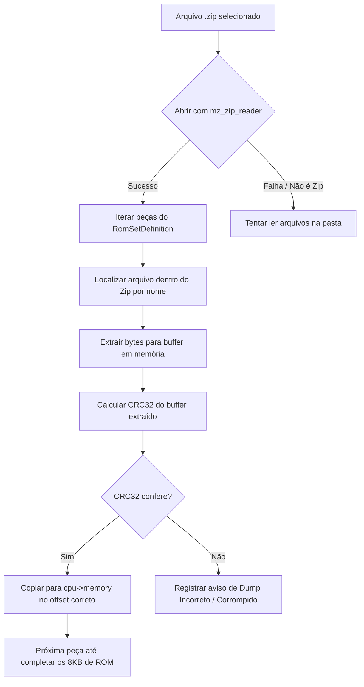

# SPEC-005: Gerenciador de ROMs, Hashes CRC32/SHA-1 e Suporte a ZIP

- **Status:** Aprovado para Implementação (Sprint 4)
- **Autor:** Game Developer / Systems Specialist
- **Arquivos Afetados:** `src/rom_manager.h`, `src/rom_manager.c`, `src/miniz.h`, `src/miniz.c`, [`src/cpu8080.h`](file:///D:/projetos/008-space-invaders-emulator/src/cpu8080.h), [`src/cpu8080.c`](file:///D:/projetos/008-space-invaders-emulator/src/cpu8080.c)
- **Dependências:** [`SPEC-004`](SPEC-004-cmake-crossplatform-build.md)

---

## 1. Contexto e Motivação
Atualmente, as ROMs do jogo são carregadas de forma estática no [`src/main.c#L28-L35`](file:///D:/projetos/008-space-invaders-emulator/src/main.c#L28-L35):
- O código procura rigidamente por `rom/invaders.h`, `rom/invaders.g`, `rom/invaders.f` e `rom/invaders.e`.
- Se um dos arquivos estiver corrompido, incompleto ou com bytes trocados, o emulador falha silenciosamente ou executa código inválido (crashes de opcode não implementado).
- No ecossistema de emulação (padrão MAME), as ROMs de arcade são distribuídas em arquivos `.zip` contendo os chips de ROM originais (EPROMs de 2KB cada).
- Para entregar um produto final moderno, o emulador deve aceitar arquivos `.zip` diretamente, calcular hashes (CRC32 / SHA-1) e verificar se o dump é autêntico antes de carregar na memória de 64 KB da CPU.

---

## 2. Requisitos

### Requisitos Funcionais (RF)
- **RF-01**: Suporte à leitura de ROMs em dois formatos:
  1. Pasta com arquivos soltos (ex: `rom/invaders.h`, etc.).
  2. Arquivo compactado `.zip` do padrão MAME (ex: `roms/invaders.zip`).
- **RF-02**: Incorporar a biblioteca **`miniz`** (implementação em C puro de domínio público contida em um único `.c`/`.h`) para descompactar arquivos ZIP diretamente na memória RAM, sem necessidade de extrair para o disco rígido.
- **RF-03**: Implementar cálculo de hash CRC32 em C para validação instantânea de cada EPROM.
- **RF-04**: Validador de integridade que compara os hashes dos arquivos carregados contra um banco de dados interno de ROMs conhecidas.
- **RF-05**: Mensagens de erro amigáveis para o usuário caso um arquivo esteja ausente, com tamanho divergente ou corrompido.

### Requisitos Não-Funcionais (RNF)
- **RNF-01**: Zero dependências externas de bibliotecas dinâmicas pesadas (como `libzip` ou `zlib`); todo o código de extração ZIP e CRC32 deve estar embutido no binário.
- **RNF-02**: Tempo de validação e carga de um arquivo ZIP inferior a 50 milissegundos.

---

## 3. Especificação Técnica e Arquitetura

### 3.1 Estruturas de Dados (`src/rom_manager.h`)
```c
#ifndef ROM_MANAGER_H
#define ROM_MANAGER_H

#include <stdint.h>
#include <stddef.h>
#include "cpu8080.h"

#define MAX_ROM_PIECES 8

typedef struct {
    const char *nome_arquivo;
    uint16_t offset_memoria;
    size_t tamanho_esperado;
    uint32_t crc32_esperado;
} RomPiece;

typedef struct {
    const char *id_jogo;          // Ex: "invaders"
    const char *titulo;           // Ex: "Space Invaders (1978)"
    int num_pecas;
    RomPiece pecas[MAX_ROM_PIECES];
} RomSetDefinition;

// Funções públicas
uint32_t calcular_crc32(const uint8_t *dados, size_t tamanho);
int carregar_romset(State8080 *cpu, const RomSetDefinition *def, const char *caminho_ou_zip);
int verificar_romset(const RomSetDefinition *def, const char *caminho_ou_zip, char *msg_erro, size_t max_len);

#endif
```

### 3.2 Tabela de Hashes Oficiais do Space Invaders (Midway 1978)
```c
static const RomSetDefinition ROMSET_INVADERS = {
    .id_jogo = "invaders",
    .titulo = "Space Invaders (Midway 1978)",
    .num_pecas = 4,
    .pecas = {
        { "invaders.h", 0x0000, 2048, 0x739F57C7 },
        { "invaders.g", 0x0800, 2048, 0x0A16404B },
        { "invaders.f", 0x1000, 2048, 0x51E28169 },
        { "invaders.e", 0x1800, 2048, 0x76B55E2D }
    }
};
```

### 3.3 Fluxo de Carregamento com `miniz`


---

## 4. Critérios de Aceite (Definition of Done)
- [x] O emulador abre e executa o jogo passando diretamente o caminho de um arquivo `invaders.zip`.
- [x] O emulador continua compatível com a pasta de arquivos descompactados `rom/`.
- [x] Se um arquivo ZIP possuir uma ROM de tamanho incorreto ou hash divergente, o sistema exibe aviso legível com o CRC obtido versus o esperado.
- [x] Biblioteca `miniz` integrada e compilando sem erros em Windows e Linux.

---

## 5. Roteiro de Testes de Q/A

| Teste | Descrição | Ação | Resultado Esperado |
| :--- | :--- | :--- | :--- |
| **TC-005-A** | Carga de `invaders.zip` do MAME | Colocar `invaders.zip` autêntico e executar `./space_invaders roms/invaders.zip`. | O jogo inicia imediatamente sem necessidade de descompactar no disco. |
| **TC-005-B** | Validação de CRC32 | Modificar 1 byte de `invaders.h` dentro do ZIP ou pasta. | O console exibe `[AVISO] CRC32 incorreto para invaders.h: Obtido 0xXXXXXXXX, Esperado 0x739F57C7`. |
| **TC-005-C** | Arquivo Ausente | Renomear `invaders.e` para `invaders.bak`. | O emulador alerta: `[ERRO] Arquivo obrigatório não encontrado: invaders.e` e encerra com segurança sem crash. |
