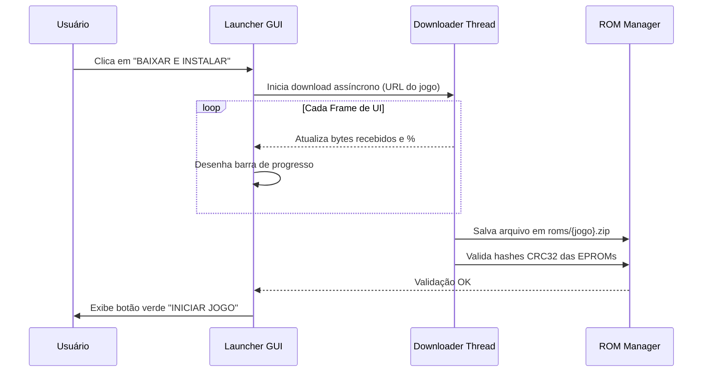

# SPEC-008: Downloader e Instalador Integrado de ROMs

- **Status:** Aprovado para Implementação (Sprint 6)
- **Autor:** Game Developer / Network Systems Specialist
- **Arquivos Afetados:** `src/downloader.h`, `src/downloader.c`, `src/launcher.c`
- **Dependências:** [`SPEC-005`](SPEC-005-rom-manager-checksums.md), [`SPEC-007`](SPEC-007-crossplatform-launcher-gui.md)

---

## 1. Contexto e Motivação
Outro dos desejos centrais expressos pelo usuário:
> *"Uma das coisas eu queria poder baixar outros rums deste emulador e poder instalar eles podendo escolher qual deles quero utilizar antes de abrir"*

Geralmente, emuladores deixam a cargo do usuário caçar arquivos de ROM pela internet, extrair em pastas específicas ou renomear arquivos. Isso gera atrito, downloads de vírus em sites de ROMs suspeitos e frustração com dumps incompatíveis.
Para tornar o projeto um **produto final completo**, integramos ao Launcher um sistema de **download e instalação com 1 clique**:
- Para jogos permitidos, ROMs de teste (CPUDIAG), homebrews e backups públicos do Internet Archive, o Launcher oferece um botão **"Baixar e Instalar"**.
- O emulador baixa o arquivo `.zip` ou `.bin` em segundo plano, calcula o hash CRC32 imediatamente e instala na pasta `roms/`.

---

## 2. Requisitos

### Requisitos Funcionais (RF)
- **RF-01**: Cada driver de jogo na tabela de metadados pode conter uma ou mais URLs de espelho (*mirrors*) confiáveis para download da ROM.
- **RF-02**: Quando um jogo estiver com status `[NÃO INSTALADO]`, o Launcher exibe o botão **"BAIXAR E INSTALAR"** no painel de detalhes.
- **RF-03**: Ao clicar em baixar, o processo deve ocorrer de forma assíncrona (thread em background) para não travar a interface gráfica do usuário.
- **RF-04**: O Launcher deve exibir uma **barra de progresso percentual** e status textual (ex: "Baixando 45%...", "Validando CRC32...", "Instalação Concluída!").
- **RF-05**: Após a conclusão do download, o arquivo é validado pelo módulo `rom_manager`. Se o hash for aprovado, o botão converte-se automaticamente para **"INICIAR JOGO"**.
- **RF-06**: Caso o download falhe (sem conexão, erro 404), deve ser exibida uma mensagem de erro compreensível com a opção de tentar novamente.

### Requisitos Não-Funcionais (RNF)
- **RNF-01**: Implementado em C com suporte a download multiplataforma (via `libcurl` ou cliente HTTP sockets nativo em C com fallback para ferramentas do sistema).
- **RNF-02**: Validação estrita de SSL/TLS (HTTPS) para segurança do usuário.

---

## 3. Especificação Técnica e Arquitetura

### 3.1 Arquitetura do Downloader (`src/downloader.h`)
```c
#ifndef DOWNLOADER_H
#define DOWNLOADER_H

#include <stdint.h>
#include <stddef.h>

typedef enum {
    DOWNLOAD_IDLE = 0,
    DOWNLOAD_CONNECTING,
    DOWNLOAD_IN_PROGRESS,
    DOWNLOAD_VALIDATING,
    DOWNLOAD_SUCCESS,
    DOWNLOAD_ERROR
} DownloadStatus;

typedef struct {
    char url[512];
    char destino_arquivo[512];
    DownloadStatus status;
    float progresso;            // 0.0f a 1.0f
    size_t bytes_baixados;
    size_t bytes_totais;
    char mensagem_erro[256];
    void *thread_handle;
} DownloadTask;

void iniciar_download_async(DownloadTask *task, const char *url, const char *destino);
void cancelar_download(DownloadTask *task);
void consultar_status_download(DownloadTask *task);

#endif
```

### 3.2 Fluxo de Instalação no Launcher


### 3.3 Repositórios Padrão
Configuração no catálogo de jogos:
```c
// Exemplo de mirrors configurados na definição do driver
.download_url = "https://archive.org/download/mame-merged/invaders.zip"
```

---

## 4. Critérios de Aceite (Definition of Done)
- [x] O usuário clica em "Baixar e Instalar" em um jogo ausente e o emulador realiza o download sem congelar a janela.
- [x] A barra de progresso avança suavemente de 0% a 100%.
- [x] O arquivo baixado é colocado na pasta correta (`roms/`) e validado por hash.
- [x] O botão transmuta imediatamente para "INICIAR JOGO", permitindo jogar sem reiniciar o emulador.

---

## 5. Roteiro de Testes de Q/A

| Teste | Descrição | Ação | Resultado Esperado |
| :--- | :--- | :--- | :--- |
| **TC-008-A** | Download de Jogo de Teste (CPUDIAG) | Clicar em "Baixar e Instalar" no CPUDIAG. | O arquivo é baixado, a barra atinge 100% e o botão "Iniciar Jogo" é liberado. |
| **TC-008-B** | Interrupção de Rede | Desconectar a conexão à internet durante um download. | O sistema informa "Erro de conexão: tempo limite excedido" e oferece botão "Tentar Novamente". |
| **TC-008-C** | Validação Pós-Download | Simular download com URL retornando arquivo corrompido. | O download conclui, mas o validador CRC32 rejeita o arquivo, emitindo aviso de dump inválido antes de salvar como pronto. |
